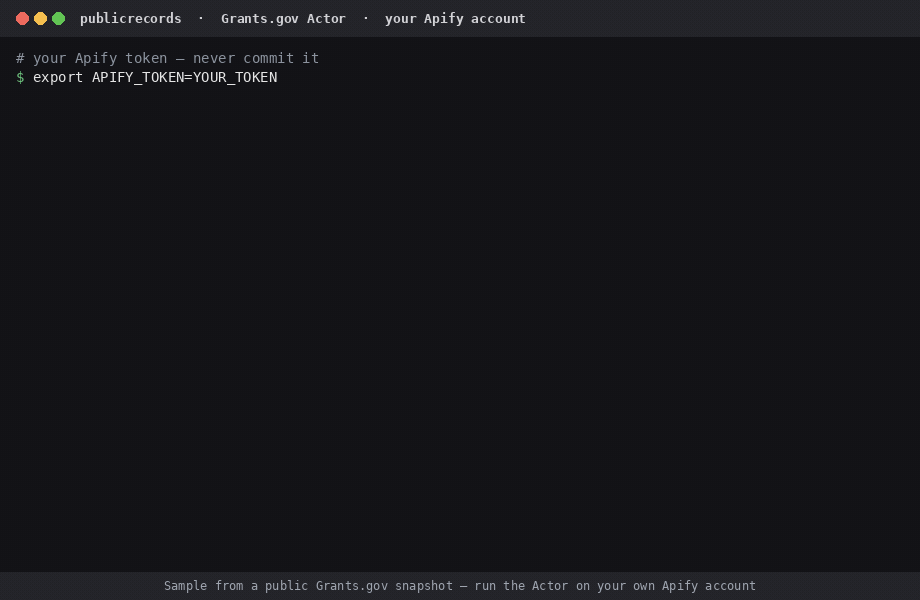

# publicrecords-mcp

**Languages:** [zh-CN](./README.zh-CN.md) · [ja](./README.ja.md) · [ko](./README.ko.md) · [de](./README.de.md) · [fr](./README.fr.md) · [es](./README.es.md) · [pt-BR](./README.pt-BR.md) · [it](./README.it.md) · [ru](./README.ru.md) · [tr](./README.tr.md) · [id](./README.id.md) · [vi](./README.vi.md) · [ar](./README.ar.md) · [hi](./README.hi.md) (localized index of all 25 registry servers; English text applies if they differ)




**Try it, tell us, and star it if it helped.** Run any Public Records Actor on your own Apify account, then [leave feedback](./BETA.md). A star is welcome if this repo saved you time. Stars are optional and are never rewarded.

**Manifest-only** pin package for [publicrecords](https://apify.com/publicrecords) Apify Actors on [Apify MCP](https://mcp.apify.com).

> This repo contains **JSON tool descriptors and MCP server cards only** — no Actor source, Dockerfiles, truth sets, or tokens.
>
> **Disclosure:** Published by the publicrecords maintainer on Apify.

**Featured on:** <a href="https://www.agenthunter.io/agent/public-records-mcp" target="_blank"> AgentHunter · Featured AI Agent</a>

## One-paste MCP pin (all live Actors)

```
https://mcp.apify.com?tools=publicrecords/company-social-profile-finder,publicrecords/eu-ted-notices-scraper,publicrecords/usaspending-awards-scraper,publicrecords/grants-gov-scraper,publicrecords/uk-find-a-tender-scraper,publicrecords/legistar-meetings-scraper
```

Crosswalk (`company-social-profile-finder`) is the **flagship** — put it first in agent tool lists.

## Install in Cursor / Claude Desktop

Copy `mcp-server.json` into your client MCP config (or merge the `mcpServers.publicrecords` block). Auth with your Apify account when the client prompts.

See also:

- Landing: https://geminigeorge22.github.io/mcp/?utm_source=github&utm_medium=readme&utm_campaign=mcp-manifest
- For agents (RAG routing): https://geminigeorge22.github.io/for-agents/
- Well-known card: https://geminigeorge22.github.io/.well-known/mcp/server-card.json
- Prompt pack: https://geminigeorge22.github.io/agents/prompt-pack.json
- Dialects: https://geminigeorge22.github.io/agents/dialects/


## Cursor plugin

This repository is a single [Cursor Plugin](https://cursor.com/docs/reference/plugins) named `publicrecords-mcp`:

- Manifest: [`.cursor-plugin/plugin.json`](./.cursor-plugin/plugin.json)
- MCP servers (all 18 remote endpoints): [`mcp.json`](./mcp.json) (identical copy at [`.mcp.json`](./.mcp.json) for the cursor.directory scanner)
- Rule: [`rules/cursor-rules.mdc`](./rules/cursor-rules.mdc) (same text as [`dialects/cursor-rules.mdc`](./dialects/cursor-rules.mdc))
- Logo (1:1 PNG with a background plate): [`assets/logo.png`](./assets/logo.png)

Connect with your own Apify account. Cursor can use Apify's OAuth flow; this repository does not contain tokens.

Repo URL for [cursor.directory/plugins/new](https://cursor.directory/plugins/new) and [Cursor Marketplace publish](https://cursor.com/marketplace/publish): `https://github.com/GeminiGeorge22/publicrecords-mcp`

## Live tools (Store)

| Brand | Actor ID | Store |
|---|---|---|
| **Crosswalk** (flagship) | `publicrecords/company-social-profile-finder` | [Store](https://apify.com/publicrecords/company-social-profile-finder) |
| EU TED Notices | `publicrecords/eu-ted-notices-scraper` | [Store](https://apify.com/publicrecords/eu-ted-notices-scraper) |
| USASpending Awards | `publicrecords/usaspending-awards-scraper` | [Store](https://apify.com/publicrecords/usaspending-awards-scraper) |
| Grants.gov | `publicrecords/grants-gov-scraper` | [Store](https://apify.com/publicrecords/grants-gov-scraper) |
| UK Find a Tender | `publicrecords/uk-find-a-tender-scraper` | [Store](https://apify.com/publicrecords/uk-find-a-tender-scraper) |
| Legistar Meetings | `publicrecords/legistar-meetings-scraper` | [Store](https://apify.com/publicrecords/legistar-meetings-scraper) |
| Tennis Scores API (Actor only; no hosted MCP) | `publicrecords/tennis-scores-api` | [Store](https://apify.com/publicrecords/tennis-scores-api) |

`publicrecords/tennis-scores-api` is an Apify Actor only: Standby/MCP mode is not built, so this repo does not publish an MCP registry entry or endpoint for it. Call it with your own Apify token via the [Apify API](https://docs.apify.com/api/v2).

Thin descriptors live under [`tools/`](./tools/). Dialects under [`dialects/`](./dialects/).

## What this is not

- Not Actor implementation code
- Not a paid run cache / digest seed
- GovCon Opportunity Feed is **not** marketed as live here

## License

MIT — applies to these manifests and descriptors only.


## One MCP server per Actor (MCP Registry)

Each folder under [`servers/`](./servers/) is a remote-only MCP Registry entry (`io.github.GeminiGeorge22/<name>`) for one Actor, served by Apify's hosted MCP gateway. Published by [`.github/workflows/publish-mcp-servers.yml`](./.github/workflows/publish-mcp-servers.yml). Four of these also have dedicated server repos (stdio packages live there): [sports-odds-mcp](https://github.com/GeminiGeorge22/sports-odds-mcp), [spotify-play-count-mcp](https://github.com/GeminiGeorge22/spotify-play-count-mcp), [google-ads-transparency-mcp](https://github.com/GeminiGeorge22/google-ads-transparency-mcp), [company-social-mcp](https://github.com/GeminiGeorge22/company-social-mcp).

| Server | Actor | Endpoint |
|---|---|---|
| [`ashby-jobs-mcp`](./servers/ashby-jobs-mcp/) | [`publicrecords/ashby-jobs-scraper`](https://apify.com/publicrecords/ashby-jobs-scraper) | `https://mcp.apify.com?tools=publicrecords/ashby-jobs-scraper` |
| [`greenhouse-jobs-mcp`](./servers/greenhouse-jobs-mcp/) | [`publicrecords/greenhouse-jobs-scraper`](https://apify.com/publicrecords/greenhouse-jobs-scraper) | `https://mcp.apify.com?tools=publicrecords/greenhouse-jobs-scraper` |
| [`lever-jobs-mcp`](./servers/lever-jobs-mcp/) | [`publicrecords/lever-jobs-scraper`](https://apify.com/publicrecords/lever-jobs-scraper) | `https://mcp.apify.com?tools=publicrecords/lever-jobs-scraper` |
| [`smartrecruiters-jobs-mcp`](./servers/smartrecruiters-jobs-mcp/) | [`publicrecords/smartrecruiters-jobs-scraper`](https://apify.com/publicrecords/smartrecruiters-jobs-scraper) | `https://mcp.apify.com?tools=publicrecords/smartrecruiters-jobs-scraper` |
| [`skool-community-mcp`](./servers/skool-community-mcp/) | [`publicrecords/skool-community-growth-tracker`](https://apify.com/publicrecords/skool-community-growth-tracker) | `https://mcp.apify.com?tools=publicrecords/skool-community-growth-tracker` |
| [`etsy-search-mcp`](./servers/etsy-search-mcp/) | [`publicrecords/etsy-search-scraper`](https://apify.com/publicrecords/etsy-search-scraper) | `https://mcp.apify.com?tools=publicrecords/etsy-search-scraper` |
| [`etsy-shop-sales-mcp`](./servers/etsy-shop-sales-mcp/) | [`publicrecords/etsy-shop-velocity`](https://apify.com/publicrecords/etsy-shop-velocity) | `https://mcp.apify.com?tools=publicrecords/etsy-shop-velocity` |
| [`calibration-ledger-mcp`](./servers/calibration-ledger-mcp/) | [`publicrecords/calibration-ledger`](https://apify.com/publicrecords/calibration-ledger) | `https://mcp.apify.com?tools=publicrecords/calibration-ledger` |
| [`govcon-opportunities-mcp`](./servers/govcon-opportunities-mcp/) | [`publicrecords/govcon-opportunity-feed`](https://apify.com/publicrecords/govcon-opportunity-feed) | `https://mcp.apify.com?tools=publicrecords/govcon-opportunity-feed` |
| [`grants-gov-mcp`](./servers/grants-gov-mcp/) | [`publicrecords/grants-gov-scraper`](https://apify.com/publicrecords/grants-gov-scraper) | `https://mcp.apify.com?tools=publicrecords/grants-gov-scraper` |
| [`usaspending-awards-mcp`](./servers/usaspending-awards-mcp/) | [`publicrecords/usaspending-awards-scraper`](https://apify.com/publicrecords/usaspending-awards-scraper) | `https://mcp.apify.com?tools=publicrecords/usaspending-awards-scraper` |
| [`uk-tenders-mcp`](./servers/uk-tenders-mcp/) | [`publicrecords/uk-find-a-tender-scraper`](https://apify.com/publicrecords/uk-find-a-tender-scraper) | `https://mcp.apify.com?tools=publicrecords/uk-find-a-tender-scraper` |
| [`eu-ted-tenders-mcp`](./servers/eu-ted-tenders-mcp/) | [`publicrecords/eu-ted-notices-scraper`](https://apify.com/publicrecords/eu-ted-notices-scraper) | `https://mcp.apify.com?tools=publicrecords/eu-ted-notices-scraper` |
| [`legistar-council-meetings-mcp`](./servers/legistar-council-meetings-mcp/) | [`publicrecords/legistar-meetings-scraper`](https://apify.com/publicrecords/legistar-meetings-scraper) | `https://mcp.apify.com?tools=publicrecords/legistar-meetings-scraper` |
| [`company-social-mcp`](./servers/company-social-mcp/) | [`publicrecords/company-social-profile-finder`](https://apify.com/publicrecords/company-social-profile-finder) | `https://mcp.apify.com?tools=publicrecords/company-social-profile-finder` |
| [`google-ads-transparency-mcp`](./servers/google-ads-transparency-mcp/) | [`publicrecords/google-ads-transparency-scraper`](https://apify.com/publicrecords/google-ads-transparency-scraper) | `https://mcp.apify.com?tools=publicrecords/google-ads-transparency-scraper` |
| [`sports-odds-api`](./servers/sports-odds-api/) | [`publicrecords/sports-odds-api`](https://apify.com/publicrecords/sports-odds-api) | `https://mcp.apify.com?tools=publicrecords/sports-odds-api` |
| [`spotify-play-count-mcp`](./servers/spotify-play-count-mcp/) | [`publicrecords/spotify-play-count-scraper`](https://apify.com/publicrecords/spotify-play-count-scraper) | `https://mcp.apify.com?tools=publicrecords/spotify-play-count-scraper` |

<!-- one-click-install-index:start -->
## One-click install (all 18 servers)

| Actor | VS Code | Cursor | Streamable HTTP endpoint (Zed, JetBrains, Claude Code, Gemini CLI, Codex, Windsurf, Cline, Roo, Goose, LibreChat, Cherry Studio) |
| --- | --- | --- | --- |
| [ashby-jobs-scraper](https://apify.com/publicrecords/ashby-jobs-scraper) | [VS Code](https://insiders.vscode.dev/redirect/mcp/install?name=ashby-jobs-mcp&config=%7B%22type%22%3A%22http%22%2C%22url%22%3A%22https%3A%2F%2Fmcp.apify.com%3Ftools%3Dpublicrecords%2Fashby-jobs-scraper%22%7D) | [Cursor](https://cursor.com/en/install-mcp?name=ashby-jobs-mcp&config=eyJ1cmwiOiJodHRwczovL21jcC5hcGlmeS5jb20%2FdG9vbHM9cHVibGljcmVjb3Jkcy9hc2hieS1qb2JzLXNjcmFwZXIifQ%3D%3D) | `https://mcp.apify.com?tools=publicrecords/ashby-jobs-scraper` |
| [greenhouse-jobs-scraper](https://apify.com/publicrecords/greenhouse-jobs-scraper) | [VS Code](https://insiders.vscode.dev/redirect/mcp/install?name=greenhouse-jobs-mcp&config=%7B%22type%22%3A%22http%22%2C%22url%22%3A%22https%3A%2F%2Fmcp.apify.com%3Ftools%3Dpublicrecords%2Fgreenhouse-jobs-scraper%22%7D) | [Cursor](https://cursor.com/en/install-mcp?name=greenhouse-jobs-mcp&config=eyJ1cmwiOiJodHRwczovL21jcC5hcGlmeS5jb20%2FdG9vbHM9cHVibGljcmVjb3Jkcy9ncmVlbmhvdXNlLWpvYnMtc2NyYXBlciJ9) | `https://mcp.apify.com?tools=publicrecords/greenhouse-jobs-scraper` |
| [lever-jobs-scraper](https://apify.com/publicrecords/lever-jobs-scraper) | [VS Code](https://insiders.vscode.dev/redirect/mcp/install?name=lever-jobs-mcp&config=%7B%22type%22%3A%22http%22%2C%22url%22%3A%22https%3A%2F%2Fmcp.apify.com%3Ftools%3Dpublicrecords%2Flever-jobs-scraper%22%7D) | [Cursor](https://cursor.com/en/install-mcp?name=lever-jobs-mcp&config=eyJ1cmwiOiJodHRwczovL21jcC5hcGlmeS5jb20%2FdG9vbHM9cHVibGljcmVjb3Jkcy9sZXZlci1qb2JzLXNjcmFwZXIifQ%3D%3D) | `https://mcp.apify.com?tools=publicrecords/lever-jobs-scraper` |
| [smartrecruiters-jobs-scraper](https://apify.com/publicrecords/smartrecruiters-jobs-scraper) | [VS Code](https://insiders.vscode.dev/redirect/mcp/install?name=smartrecruiters-jobs-mcp&config=%7B%22type%22%3A%22http%22%2C%22url%22%3A%22https%3A%2F%2Fmcp.apify.com%3Ftools%3Dpublicrecords%2Fsmartrecruiters-jobs-scraper%22%7D) | [Cursor](https://cursor.com/en/install-mcp?name=smartrecruiters-jobs-mcp&config=eyJ1cmwiOiJodHRwczovL21jcC5hcGlmeS5jb20%2FdG9vbHM9cHVibGljcmVjb3Jkcy9zbWFydHJlY3J1aXRlcnMtam9icy1zY3JhcGVyIn0%3D) | `https://mcp.apify.com?tools=publicrecords/smartrecruiters-jobs-scraper` |
| [etsy-search-scraper](https://apify.com/publicrecords/etsy-search-scraper) | [VS Code](https://insiders.vscode.dev/redirect/mcp/install?name=etsy-search-mcp&config=%7B%22type%22%3A%22http%22%2C%22url%22%3A%22https%3A%2F%2Fmcp.apify.com%3Ftools%3Dpublicrecords%2Fetsy-search-scraper%22%7D) | [Cursor](https://cursor.com/en/install-mcp?name=etsy-search-mcp&config=eyJ1cmwiOiJodHRwczovL21jcC5hcGlmeS5jb20%2FdG9vbHM9cHVibGljcmVjb3Jkcy9ldHN5LXNlYXJjaC1zY3JhcGVyIn0%3D) | `https://mcp.apify.com?tools=publicrecords/etsy-search-scraper` |
| [etsy-shop-velocity](https://apify.com/publicrecords/etsy-shop-velocity) | [VS Code](https://insiders.vscode.dev/redirect/mcp/install?name=etsy-shop-sales-mcp&config=%7B%22type%22%3A%22http%22%2C%22url%22%3A%22https%3A%2F%2Fmcp.apify.com%3Ftools%3Dpublicrecords%2Fetsy-shop-velocity%22%7D) | [Cursor](https://cursor.com/en/install-mcp?name=etsy-shop-sales-mcp&config=eyJ1cmwiOiJodHRwczovL21jcC5hcGlmeS5jb20%2FdG9vbHM9cHVibGljcmVjb3Jkcy9ldHN5LXNob3AtdmVsb2NpdHkifQ%3D%3D) | `https://mcp.apify.com?tools=publicrecords/etsy-shop-velocity` |
| [calibration-ledger](https://apify.com/publicrecords/calibration-ledger) | [VS Code](https://insiders.vscode.dev/redirect/mcp/install?name=calibration-ledger-mcp&config=%7B%22type%22%3A%22http%22%2C%22url%22%3A%22https%3A%2F%2Fmcp.apify.com%3Ftools%3Dpublicrecords%2Fcalibration-ledger%22%7D) | [Cursor](https://cursor.com/en/install-mcp?name=calibration-ledger-mcp&config=eyJ1cmwiOiJodHRwczovL21jcC5hcGlmeS5jb20%2FdG9vbHM9cHVibGljcmVjb3Jkcy9jYWxpYnJhdGlvbi1sZWRnZXIifQ%3D%3D) | `https://mcp.apify.com?tools=publicrecords/calibration-ledger` |
| [govcon-opportunity-feed](https://apify.com/publicrecords/govcon-opportunity-feed) | [VS Code](https://insiders.vscode.dev/redirect/mcp/install?name=govcon-opportunities-mcp&config=%7B%22type%22%3A%22http%22%2C%22url%22%3A%22https%3A%2F%2Fmcp.apify.com%3Ftools%3Dpublicrecords%2Fgovcon-opportunity-feed%22%7D) | [Cursor](https://cursor.com/en/install-mcp?name=govcon-opportunities-mcp&config=eyJ1cmwiOiJodHRwczovL21jcC5hcGlmeS5jb20%2FdG9vbHM9cHVibGljcmVjb3Jkcy9nb3Zjb24tb3Bwb3J0dW5pdHktZmVlZCJ9) | `https://mcp.apify.com?tools=publicrecords/govcon-opportunity-feed` |
| [grants-gov-scraper](https://apify.com/publicrecords/grants-gov-scraper) | [VS Code](https://insiders.vscode.dev/redirect/mcp/install?name=grants-gov-mcp&config=%7B%22type%22%3A%22http%22%2C%22url%22%3A%22https%3A%2F%2Fmcp.apify.com%3Ftools%3Dpublicrecords%2Fgrants-gov-scraper%22%7D) | [Cursor](https://cursor.com/en/install-mcp?name=grants-gov-mcp&config=eyJ1cmwiOiJodHRwczovL21jcC5hcGlmeS5jb20%2FdG9vbHM9cHVibGljcmVjb3Jkcy9ncmFudHMtZ292LXNjcmFwZXIifQ%3D%3D) | `https://mcp.apify.com?tools=publicrecords/grants-gov-scraper` |
| [usaspending-awards-scraper](https://apify.com/publicrecords/usaspending-awards-scraper) | [VS Code](https://insiders.vscode.dev/redirect/mcp/install?name=usaspending-awards-mcp&config=%7B%22type%22%3A%22http%22%2C%22url%22%3A%22https%3A%2F%2Fmcp.apify.com%3Ftools%3Dpublicrecords%2Fusaspending-awards-scraper%22%7D) | [Cursor](https://cursor.com/en/install-mcp?name=usaspending-awards-mcp&config=eyJ1cmwiOiJodHRwczovL21jcC5hcGlmeS5jb20%2FdG9vbHM9cHVibGljcmVjb3Jkcy91c2FzcGVuZGluZy1hd2FyZHMtc2NyYXBlciJ9) | `https://mcp.apify.com?tools=publicrecords/usaspending-awards-scraper` |
| [uk-find-a-tender-scraper](https://apify.com/publicrecords/uk-find-a-tender-scraper) | [VS Code](https://insiders.vscode.dev/redirect/mcp/install?name=uk-tenders-mcp&config=%7B%22type%22%3A%22http%22%2C%22url%22%3A%22https%3A%2F%2Fmcp.apify.com%3Ftools%3Dpublicrecords%2Fuk-find-a-tender-scraper%22%7D) | [Cursor](https://cursor.com/en/install-mcp?name=uk-tenders-mcp&config=eyJ1cmwiOiJodHRwczovL21jcC5hcGlmeS5jb20%2FdG9vbHM9cHVibGljcmVjb3Jkcy91ay1maW5kLWEtdGVuZGVyLXNjcmFwZXIifQ%3D%3D) | `https://mcp.apify.com?tools=publicrecords/uk-find-a-tender-scraper` |
| [eu-ted-notices-scraper](https://apify.com/publicrecords/eu-ted-notices-scraper) | [VS Code](https://insiders.vscode.dev/redirect/mcp/install?name=eu-ted-tenders-mcp&config=%7B%22type%22%3A%22http%22%2C%22url%22%3A%22https%3A%2F%2Fmcp.apify.com%3Ftools%3Dpublicrecords%2Feu-ted-notices-scraper%22%7D) | [Cursor](https://cursor.com/en/install-mcp?name=eu-ted-tenders-mcp&config=eyJ1cmwiOiJodHRwczovL21jcC5hcGlmeS5jb20%2FdG9vbHM9cHVibGljcmVjb3Jkcy9ldS10ZWQtbm90aWNlcy1zY3JhcGVyIn0%3D) | `https://mcp.apify.com?tools=publicrecords/eu-ted-notices-scraper` |
| [legistar-meetings-scraper](https://apify.com/publicrecords/legistar-meetings-scraper) | [VS Code](https://insiders.vscode.dev/redirect/mcp/install?name=legistar-council-meetings-mcp&config=%7B%22type%22%3A%22http%22%2C%22url%22%3A%22https%3A%2F%2Fmcp.apify.com%3Ftools%3Dpublicrecords%2Flegistar-meetings-scraper%22%7D) | [Cursor](https://cursor.com/en/install-mcp?name=legistar-council-meetings-mcp&config=eyJ1cmwiOiJodHRwczovL21jcC5hcGlmeS5jb20%2FdG9vbHM9cHVibGljcmVjb3Jkcy9sZWdpc3Rhci1tZWV0aW5ncy1zY3JhcGVyIn0%3D) | `https://mcp.apify.com?tools=publicrecords/legistar-meetings-scraper` |
| [company-social-profile-finder](https://apify.com/publicrecords/company-social-profile-finder) | [VS Code](https://insiders.vscode.dev/redirect/mcp/install?name=company-social-mcp&config=%7B%22type%22%3A%22http%22%2C%22url%22%3A%22https%3A%2F%2Fmcp.apify.com%3Ftools%3Dpublicrecords%2Fcompany-social-profile-finder%22%7D) | [Cursor](https://cursor.com/en/install-mcp?name=company-social-mcp&config=eyJ1cmwiOiJodHRwczovL21jcC5hcGlmeS5jb20%2FdG9vbHM9cHVibGljcmVjb3Jkcy9jb21wYW55LXNvY2lhbC1wcm9maWxlLWZpbmRlciJ9) | `https://mcp.apify.com?tools=publicrecords/company-social-profile-finder` |
| [google-ads-transparency-scraper](https://apify.com/publicrecords/google-ads-transparency-scraper) | [VS Code](https://insiders.vscode.dev/redirect/mcp/install?name=google-ads-transparency-mcp&config=%7B%22type%22%3A%22http%22%2C%22url%22%3A%22https%3A%2F%2Fmcp.apify.com%3Ftools%3Dpublicrecords%2Fgoogle-ads-transparency-scraper%22%7D) | [Cursor](https://cursor.com/en/install-mcp?name=google-ads-transparency-mcp&config=eyJ1cmwiOiJodHRwczovL21jcC5hcGlmeS5jb20%2FdG9vbHM9cHVibGljcmVjb3Jkcy9nb29nbGUtYWRzLXRyYW5zcGFyZW5jeS1zY3JhcGVyIn0%3D) | `https://mcp.apify.com?tools=publicrecords/google-ads-transparency-scraper` |
| [sports-odds-api](https://apify.com/publicrecords/sports-odds-api) | [VS Code](https://insiders.vscode.dev/redirect/mcp/install?name=sports-odds-api&config=%7B%22type%22%3A%22http%22%2C%22url%22%3A%22https%3A%2F%2Fmcp.apify.com%3Ftools%3Dpublicrecords%2Fsports-odds-api%22%7D) | [Cursor](https://cursor.com/en/install-mcp?name=sports-odds-api&config=eyJ1cmwiOiJodHRwczovL21jcC5hcGlmeS5jb20%2FdG9vbHM9cHVibGljcmVjb3Jkcy9zcG9ydHMtb2Rkcy1hcGkifQ%3D%3D) | `https://mcp.apify.com?tools=publicrecords/sports-odds-api` |
| [spotify-play-count-scraper](https://apify.com/publicrecords/spotify-play-count-scraper) | [VS Code](https://insiders.vscode.dev/redirect/mcp/install?name=spotify-play-count-mcp&config=%7B%22type%22%3A%22http%22%2C%22url%22%3A%22https%3A%2F%2Fmcp.apify.com%3Ftools%3Dpublicrecords%2Fspotify-play-count-scraper%22%7D) | [Cursor](https://cursor.com/en/install-mcp?name=spotify-play-count-mcp&config=eyJ1cmwiOiJodHRwczovL21jcC5hcGlmeS5jb20%2FdG9vbHM9cHVibGljcmVjb3Jkcy9zcG90aWZ5LXBsYXktY291bnQtc2NyYXBlciJ9) | `https://mcp.apify.com?tools=publicrecords/spotify-play-count-scraper` |
| [skool-community-growth-tracker](https://apify.com/publicrecords/skool-community-growth-tracker) | [VS Code](https://insiders.vscode.dev/redirect/mcp/install?name=skool-community-mcp&config=%7B%22type%22%3A%22http%22%2C%22url%22%3A%22https%3A%2F%2Fmcp.apify.com%3Ftools%3Dpublicrecords%2Fskool-community-growth-tracker%22%7D) | [Cursor](https://cursor.com/en/install-mcp?name=skool-community-mcp&config=eyJ1cmwiOiJodHRwczovL21jcC5hcGlmeS5jb20%2FdG9vbHM9cHVibGljcmVjb3Jkcy9za29vbC1jb21tdW5pdHktZ3Jvd3RoLXRyYWNrZXIifQ%3D%3D) | `https://mcp.apify.com?tools=publicrecords/skool-community-growth-tracker` |
<!-- one-click-install-index:end -->

## Beta testers

We are looking for people who will run an Actor on their own Apify account and tell us what broke or what they needed. Useful feedback (a bug report, a review, or a use case) can be credited here, gets first pick on new Actor and feature requests, and gets early access to new Actors. Stars are optional and are never part of that.

See [BETA.md](./BETA.md) for how to join and how to report.

_No testers credited yet. If you send feedback, you can be first._
